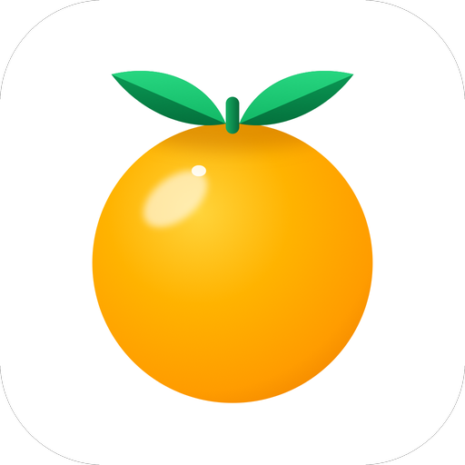

<p align="center">
  
</p>

<h1 align="center">Melogold Server</h1>

<p align="center">Сервер синхронизации <a href="https://github.com/melogold-app/melogoldAndroid">Melogold</a>: общие избранное, библиотека и плейлисты на всех устройствах пользователя.</p>

## Что хранит сервер

- аккаунты (регистрация по логину и паролю);
- треки как ссылки на YouTube Music (`videoId` и отображаемые данные);
- избранное, библиотеку и плейлисты пользователя;
- список подключённых устройств с возможностью отключить любое.

**Аудио на сервере нет.** Музыку каждый клиент получает из YouTube Music сам.

## Собственный сервер

Публичный экземпляр закрывается 21 ноября 2026 года. Для синхронизации разверните свой сервер и укажите его адрес в клиентах. Без подключения библиотека остаётся на устройстве.

### Свой сервер одной командой

Linux x86_64 или aarch64, 1 ГБ памяти, Docker (установщик может поставить его сам):

```sh
curl -fsSL https://github.com/melogold-app/melogoldServer/releases/latest/download/install.sh | sudo sh
```

В терминале выберите режим подключения и создайте аккаунт владельца. Установщик выведет адрес и QR-код. В клиенте откройте «Настройки → Сервер Melogold», укажите этот адрес и войдите в аккаунт. Дальше сервером управляет команда `melogold`:
`status`, `logs`, `backup`, `restore`, `upgrade`, `user add`, `qr`. Подробно:
[установка](docs/self-hosting.md), [эксплуатация](docs/operations.md).

## Статус

В разработке. Стек: Node.js 24, TypeScript, Fastify 5, Kysely (SQLite по умолчанию или PostgreSQL), OpenAPI 3.0.

Документация:
- [Архитектура](docs/DESIGN.md)
- [Контракт API](docs/API.md) — единый для всех клиентов
- [План реализации](docs/PLAN.md)
- [Свой сервер](docs/self-hosting.md) и [эксплуатация](docs/operations.md)

## Лицензия

[AGPL-3.0](./LICENSE). Если вы запускаете изменённую версию сервера для других пользователей, вы обязаны опубликовать её исходный код.

## Остальные части Melogold

| Платформа | Репозиторий |
|---|---|
| Android | [melogoldAndroid](https://github.com/melogold-app/melogoldAndroid) |
| Сервер | [melogoldServer](https://github.com/melogold-app/melogoldServer) |
| Windows | [melogoldWindows](https://github.com/melogold-app/melogoldWindows) |
| Linux | [melogoldLinux](https://github.com/melogold-app/melogoldLinux) |
| iOS и macOS | [melogoldiOSmacOS](https://github.com/melogold-app/melogoldiOSmacOS) |
